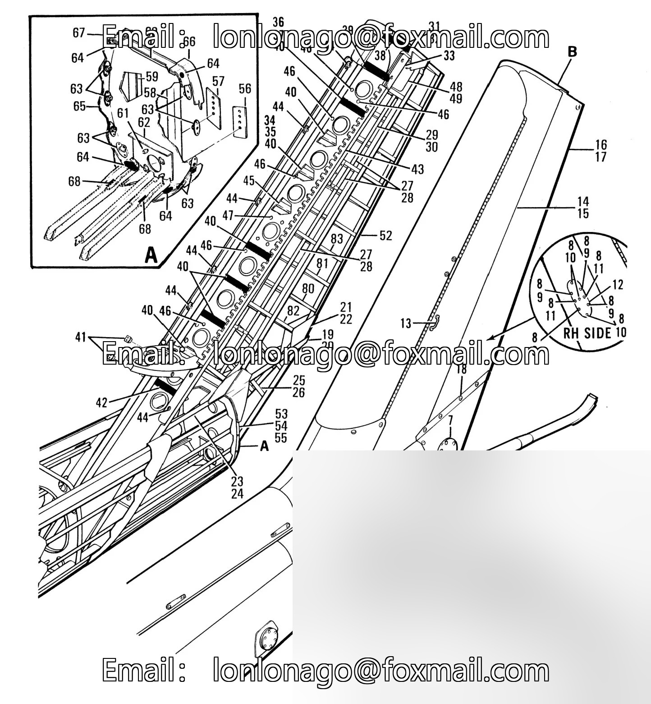
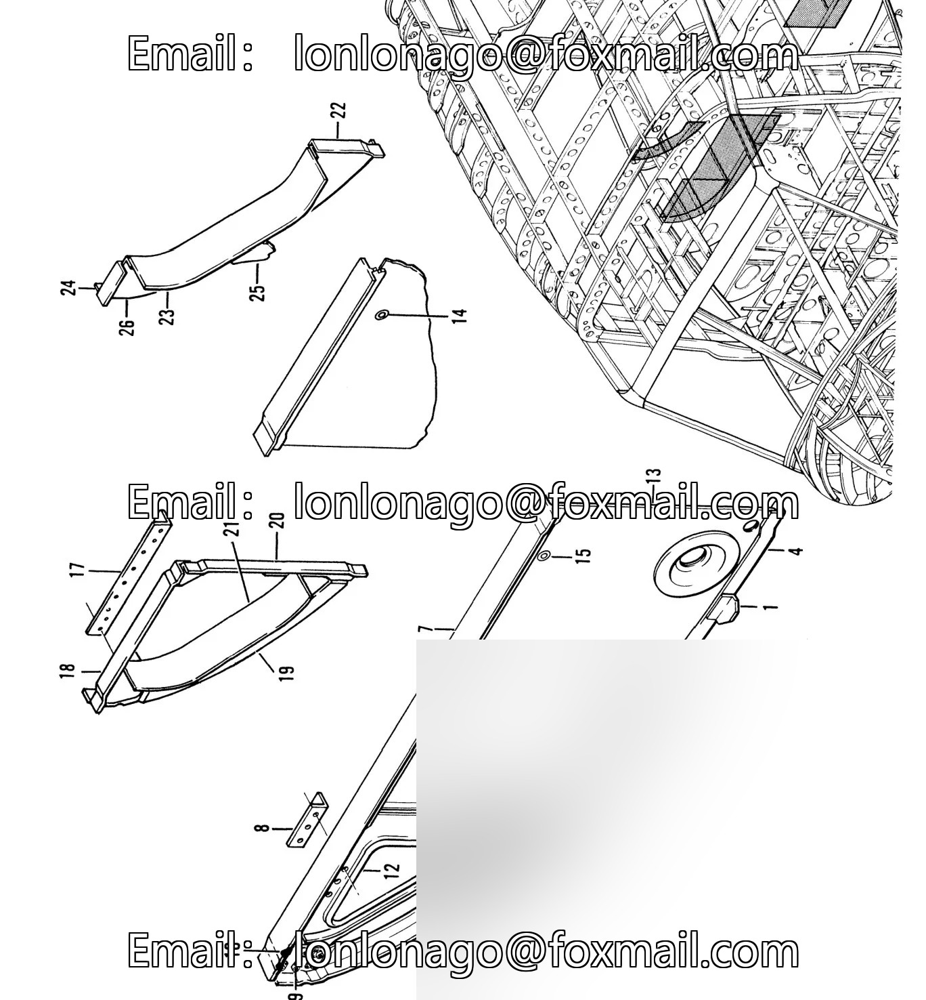
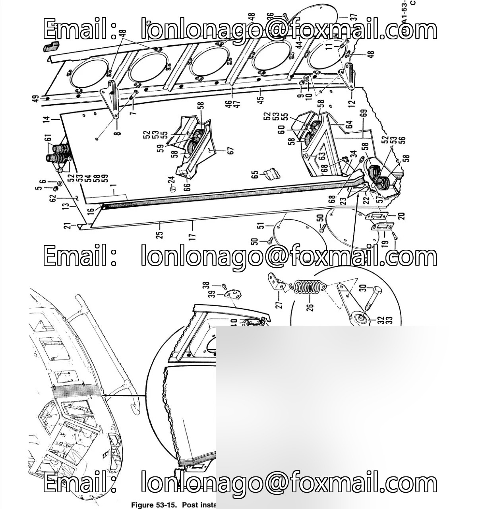

# "205A1 Helicopter Diagram Part Decomposition Manual" Chapter 53 — Body Plates.

## Body

《Belfort 205A1 Helicopter Figure and Part Diagram Decomposition Manual》 Chapter 53 — Body Structure Divisional Volume - 205A1-IPB-CH53-FUSELAGE, 300-page PDF .
once sold, it will not be refunded.

The handbook chapter 53 covers the fuselage structure volume, comprising a 300-page PDF, with the offer of refund upon sale.

<!-- AI_ENRICHED -->

## Images

## Payment

Here is a pay link on Stripe ( https://buy.stripe.com/3cs8yP7sY87d0vu9AB ). Please contact me lonlonago@foxmail.com after funding $89, and I will send you a complete data files , thank you!

